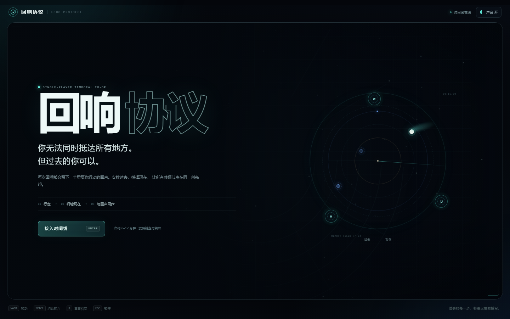
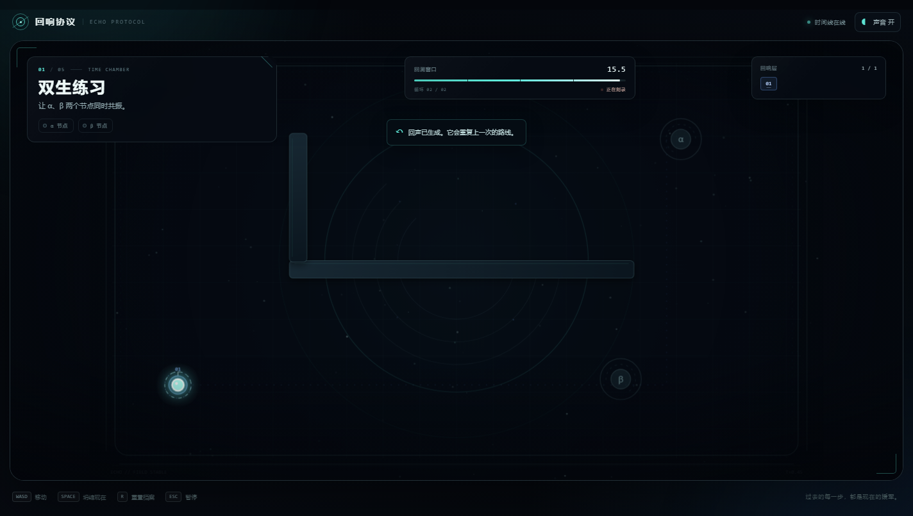
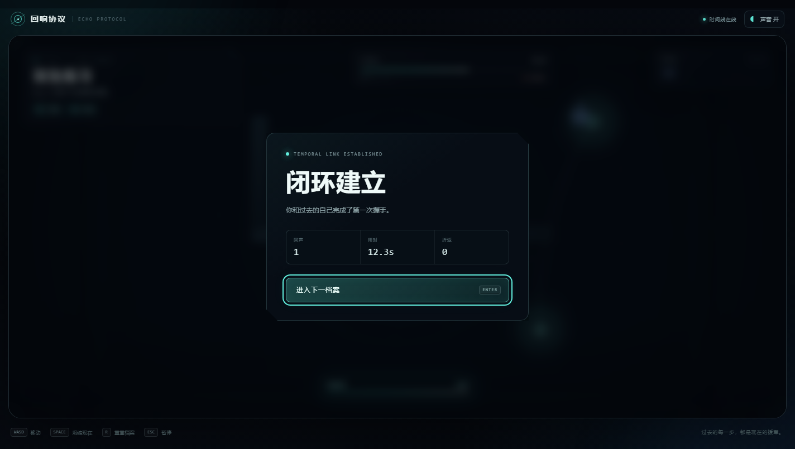
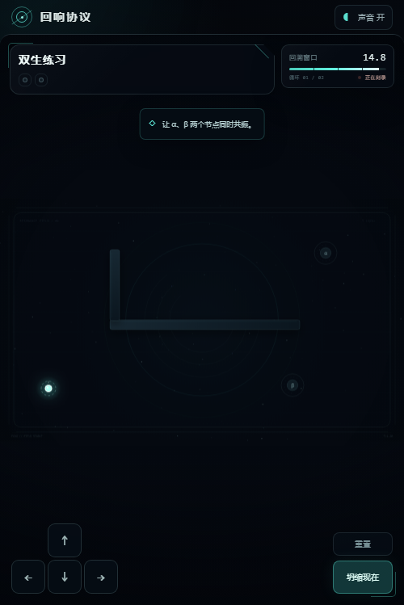
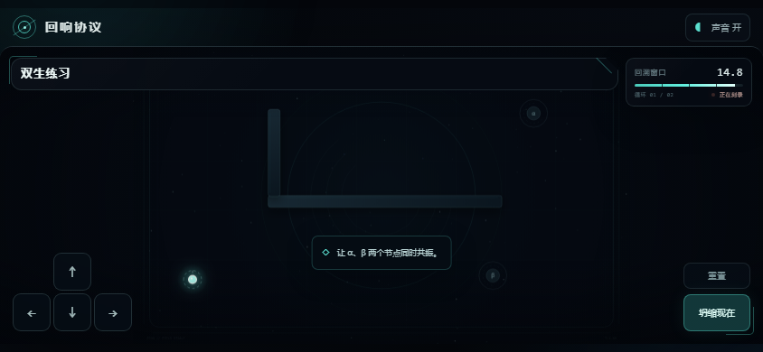

# 回响协议 · Echo Protocol

> 你无法同时抵达所有地方。但过去的你可以。



《回响协议》是一款无需安装、打开浏览器即可游玩的单人时间协作解谜游戏。

## 核心玩法

每次“坍缩现在”，刚才的行动都会被记录，并在下一轮变成一个会重复相同路线的“回声”。

你需要让现在与不同时间层的回声同时驻留所有共振节点，并维持短暂同步。过去的自己既可以替你守住机关，也会忠实复刻你走过的每一条路线。

## 游戏特色

- **单人双时态协作**：把过去变成可以编排队友，而不是简单的动作回放。
- **五个递进档案**：从双节点同步到五层回声，逐步加入迷宫与记忆扫描障碍。
- **即时时间规划**：手动坍缩当前时间线，缩短等待并快速验证解法。
- **沉浸式反馈**：Canvas 粒子、动态共振连线与程序化合成音效。
- **完整输入支持**：键盘、手机触屏和不同屏幕尺寸适配。
- **零依赖运行**：原生 HTML、CSS 和 JavaScript，无需构建工具。

## 立即游玩

直接用浏览器打开 [`index.html`](index.html)。

也可以在当前目录启动任意静态文件服务器：

```powershell
python -m http.server 8080
```

然后访问 `http://localhost:8080`。

建议在桌面或手机横屏模式下游玩。

## 操作

| 操作 | 键盘 | 触屏 |
| --- | --- | --- |
| 移动 | `WASD` / 方向键 | 左下方向键 |
| 坍缩现在、生成回声 | `Space` | 坍缩现在 |
| 重置当前档案 | `R` | 重置 |
| 暂停 | `Esc` | — |
| 声音开关 | `M` | 顶部声音按钮 |

目标是让画面中所有共振节点同时亮起。节点全部激活后，还需要短暂维持共振，闭环才会建立。

## 项目结构

```text
.
├── index.html       # 页面结构、HUD 与游戏界面
├── style.css        # 视觉样式、动画和响应式布局
├── game.js          # 游戏循环、关卡、回声回放与音效
├── screenshots/     # 桌面和移动端展示截图
└── README.md
```

## 技术说明

- HTML5 Canvas 2D
- 原生 JavaScript
- Web Audio API
- CSS 响应式布局
- 无第三方运行时依赖

游戏已在 Chrome 中完成五个关卡的端到端通关测试，并检查了桌面、手机竖屏和手机横屏布局。

## 更多截图

| 桌面游玩 | 闭环结算 |
| --- | --- |
|  |  |

| 手机竖屏 | 手机横屏 |
| --- | --- |
|  |  |
